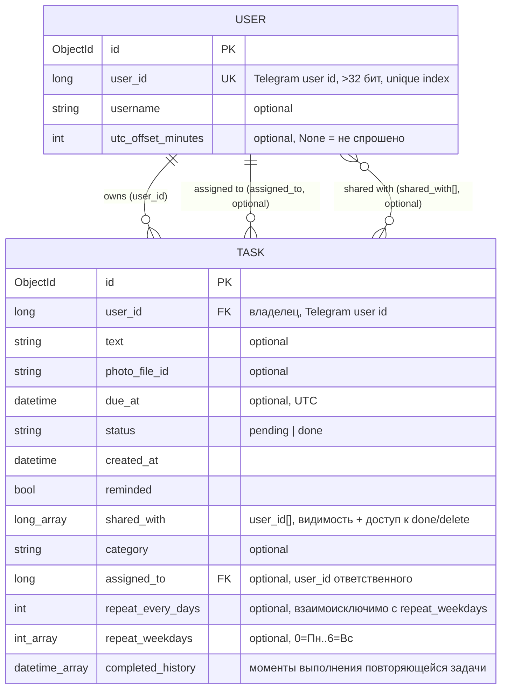
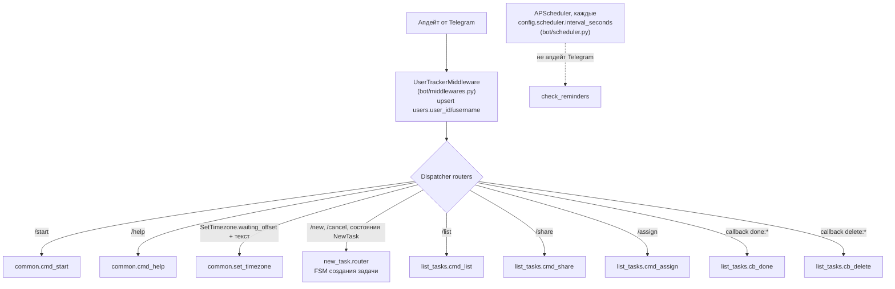
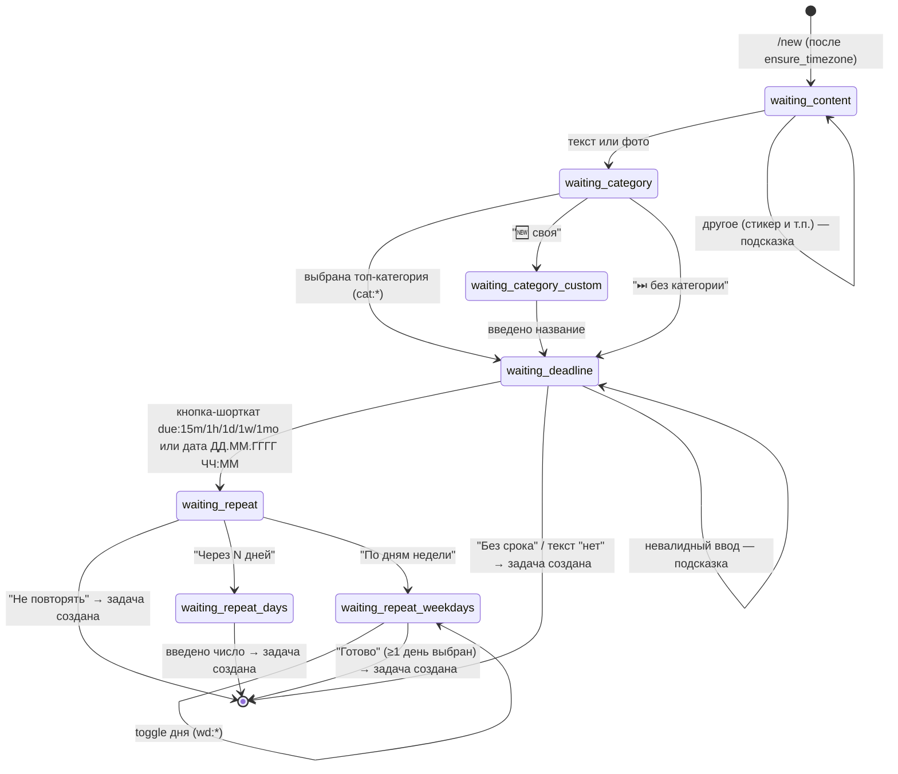
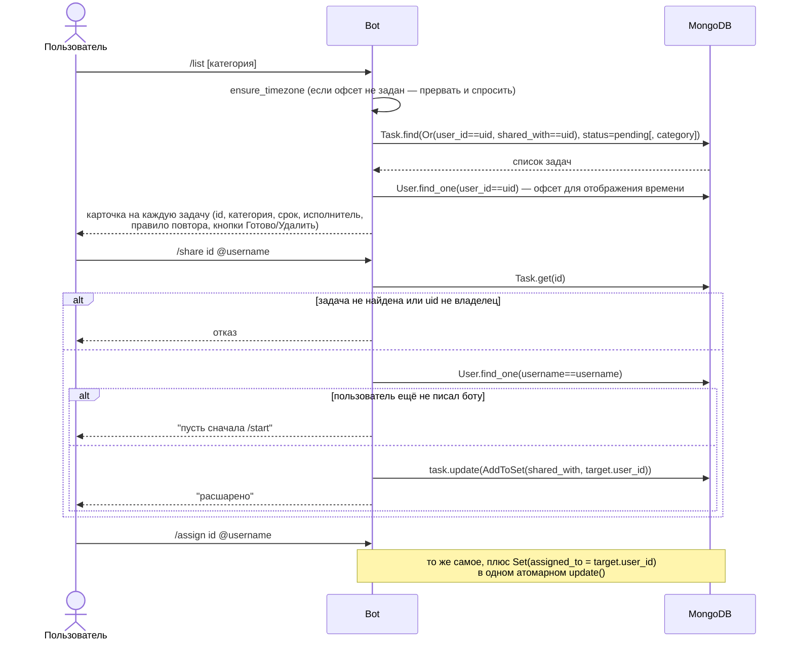
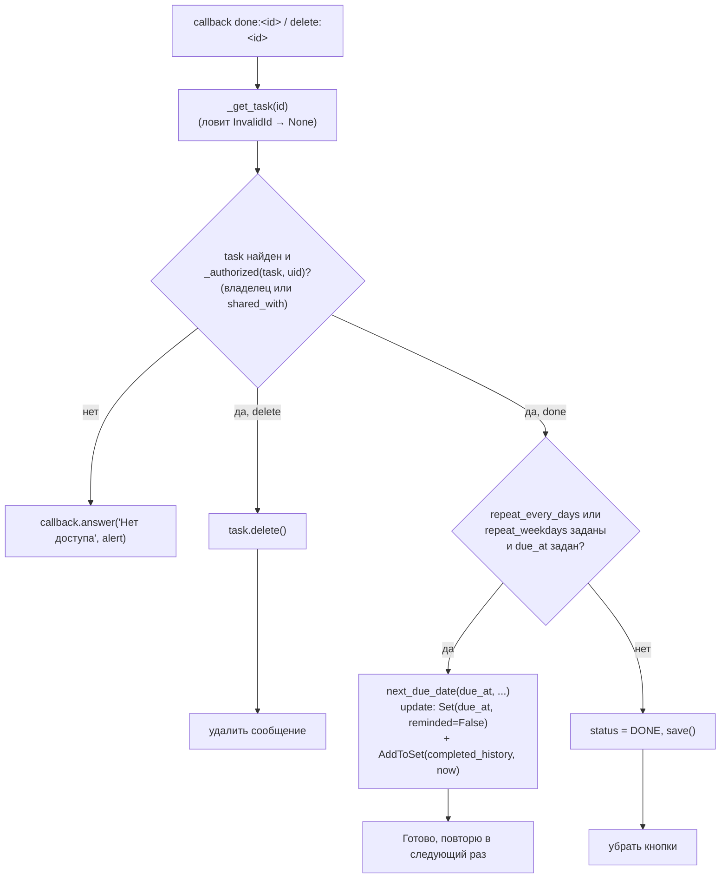
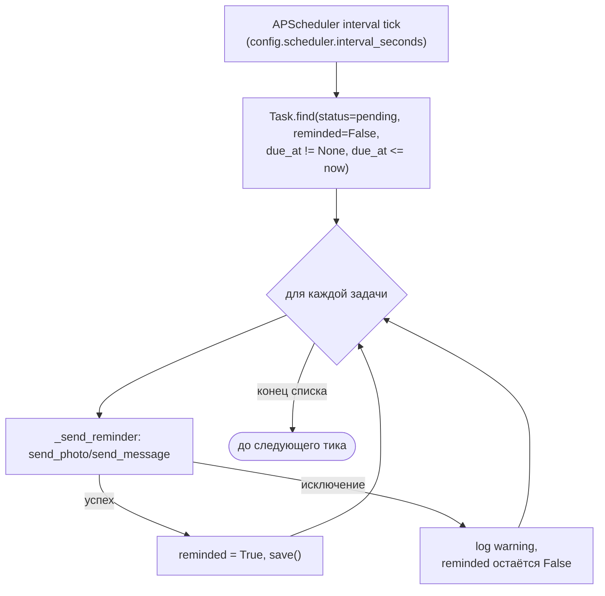

# Архитектура home-tasks-bot

Диаграммы ниже отражают код по состоянию на текущий коммит: схему двух коллекций MongoDB
(`tasks`, `users`) и путь обработки каждой команды/колбэка. При изменении моделей или хендлеров
(`bot/models.py`, `bot/handlers/*`, `bot/scheduler.py`) — обновляй и диаграммы.

## Схема данных

Mongo — документная БД без FK; связи ниже логические (через `User.user_id`), а не enforced на
уровне БД.

## Маршрутизация апдейтов

Один `Dispatcher` (`main.py:setup_bot_and_dispatcher`), три роутера, один outer-middleware,
работающий для polling и webhook одинаково (переключение режима — `config.service.webhook`).

## FSM `/new` (`bot/handlers/new_task.py`)

Шаг "повторять?" показывается только если задан срок (`waiting_deadline` может уйти сразу к
созданию задачи через кнопку "Без срока" или текст "нет").

`/cancel` (`cmd_cancel`, `StateFilter("*")`) сбрасывает FSM в `[*]` из любого состояния выше —
не показан отдельными стрелками, чтобы не дублировать каждый переход.

## `/list`, `/share`, `/assign`

Все три завязаны на общий фильтр видимости `Or(Task.user_id == uid, Task.shared_with == uid)`
(`_open_tasks_for`) — равенство скаляра с полем-массивом матчит вхождение в MongoDB.

## Колбэки `done:*` / `delete:*`

Ключевая развилка — повторяющаяся задача не помечается `done`, а перезаряжается.

## Напоминания (`bot/scheduler.py`)

`due_at != None` в запросе обязателен: BSON-порядок сравнения считает `null <= date` истинным,
без этого условия задачи без срока попадали бы под фильтр `$lte`.
